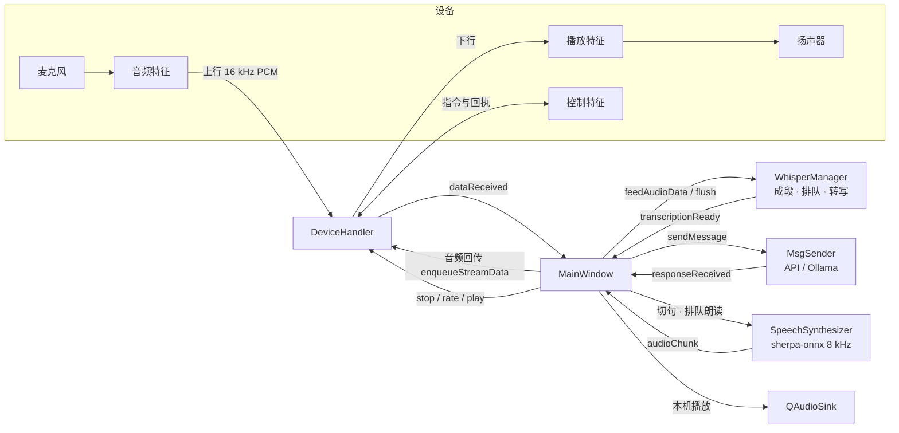

# 架构说明

术语见仓库根 `CONTEXT.md`；为什么这样做见 `docs/adr/`。本文只讲「东西在哪、怎么连起来、怎么构建和测试」。

## 一、整体数据流



`MainWindow` 不是窗口，是暴露给 QML 的后端桥接对象（`qml/Main.qml` 里叫 `backend`），
负责把各模块串起来，并持有朗读、音频回传、开发板播放会话的状态。

## 二、模块

| 文件 | 职责 | 线程 |
|---|---|---|
| `src/main.cpp` | 创建 `QGuiApplication`、QML 引擎，注入 `backend` | GUI |
| `src/mainwindow.cpp` | 接线；朗读队列与本机播放（排空定时器、重采样）；音频回传背压；开发板自动配置与播放会话（`stop`→`rate`→`play`→等 `OK:playing`）；尾音冲刷定时器 | GUI |
| `src/devicehandler.cpp` | BLE 扫描、连接、服务发现（带 10 秒超时）；激活特征的上行通知；下行队列（文本 / 流式、在途流控、水位）；控制通道；按提交顺序记账的写入错误归属；断开时统一复位 | GUI（回调来自 Qt 蓝牙） |
| `src/whisper_manager.cpp` | 后台加载 Whisper 模型；上行 PCM 成段、有界排队（4 段）、逐段转写；`reset()` 作废进行中的结果 | 加载与转写在 worker，其余 GUI |
| `src/msgsender.cpp` | 两种接入方式的单轮请求；配置持久化（`QSettings`）；超时（API 15 s / Ollama 60 s）与错误分类 | GUI（异步网络） |
| `src/speechsynthesizer.cpp` | sherpa-onnx 逐句合成；有界 PCM 队列；按代次取消；可被背压暂停排空 | 合成在 worker，排空在 GUI |
| `src/assetextractor.cpp` | 把 TTS 模型从 `assets:/` 复制到应用目录；清单 v2（应用版本 + 源资产长度）判定是否需要重提 | 调用方负责放到 worker |
| `src/sentencesplitter.cpp` | 纯函数：回复切句 | 任意 |
| `src/wavpcm.cpp` | 纯函数：从 WAV 中取出 PCM 并核对格式（「选音频」用） | 任意 |
| `qml/Main.qml` | 全部界面 | GUI |
| `firmware/esp32c3/src/main.cpp` | 开发板固件：I2S 全双工、上行通知、下行环形缓冲与整数倍插值、控制指令 | — |

几条贯穿各模块的纪律：

- **就绪才接活。** Whisper 与 TTS 都在后台加载，`isReady()` 为假时直接拒绝输入。
- **进度不走错误通道。** 错误信号只用于真正的失败；进度有单独的信号（如 `segmentQueued`）。
- **静默是正常结果。** 空文本、`[无识别结果]`、应答失败都不出声。
- **说成功之前先核实。** 自动配置逐项检查，`play` 等回执，失败时说出是哪一步。

## 三、目录

```
src/ includes/          应用源码（CMake 用 file(GLOB) 收集，新增文件后要重新 configure）
qml/                    界面
tests/                  只依赖 QtCore 的纯逻辑单元测试（桌面 host Qt 上跑）
android/                AndroidManifest 与 assets（两个模型直接入库，见 ADR 0005）
firmware/esp32c3/       开发板固件（PlatformIO）
third_party/whisper.cpp     入库的源码，随应用一起编译
third_party/sherpa-onnx     头文件与 cmake 入库，.so 由 download-libs.sh 获取
third_party/android_openssl 头文件入库，.so 目前没有获取办法（.scratch/repo-hygiene/issues/02）
.scratch/               工单与规格（入口 .scratch/README.md）
docs/adr/               决策记录
```

## 四、构建

**应用只支持 Android（arm64-v8a）。** 不维护桌面版应用的构建：在 host Qt 上配置后整体编译会因为
缺 sherpa-onnx 头文件而失败，这是预期的，不需要修。host Qt 只用来跑下面的单元测试。

### Android APK

前置：Qt 6.11.1（`android_arm64_v8a` 与 `gcc_64`）、Android SDK + NDK 27、JDK，以及两组不入库的
预编译库——`third_party/sherpa-onnx/download-libs.sh` 拉取 sherpa-onnx；OpenSSL 的 `.so` 需要
自己放进 `third_party/android_openssl/ssl_3/arm64-v8a/`。路径配置见 `.vscode/settings.example.json`。

Release 构建：

- 用仓库里的测试密钥签名（`docs/adr/0001-committed-test-signing-key.md`），不能用于对外分发；
- 启用 `-march=armv8.2-a+fp16+dotprod`，在 ARMv8.0 的老手机上会直接崩溃
  （`docs/adr/0004-require-armv8-2.md`）；
- `AUTO_INSTALL_APK` 默认开，`apk` 目标结束后会 `adb install`，没接手机时传 `-DAUTO_INSTALL_APK=OFF`。

### 固件

```bash
cd firmware/esp32c3 && pio run -t upload
```

串口监视：`pio device monitor -b 115200`。固件与应用共用的协议常量在 `includes/devicehandler.h`
的 `BoardProtocol`，两边改一边必须同步另一边（包括回执文本）。

### 单元测试

只编译被测的那一个源文件，不链接整个应用；用桌面版 Qt：

```bash
cmake -B build-tests -DCMAKE_BUILD_TYPE=Debug -DCMAKE_PREFIX_PATH=/opt/Qt/6.11.1/gcc_64
```

```bash
cmake --build build-tests --target tst_sentencesplitter tst_wavpcm tst_assetextractor
```

```bash
ctest --test-dir build-tests --output-on-failure
```

| 测试 | 被测 |
|---|---|
| `tst_sentencesplitter` | 切句 |
| `tst_wavpcm` | WAV 解析与格式校验 |
| `tst_assetextractor` | 模型提取与过期判定（用临时目录模拟 assets） |

依赖蓝牙、Whisper、sherpa-onnx 的部分没有自动化测试，靠 `.scratch/` 里各专题的真机验收工单。
新增测试在 `tests/CMakeLists.txt` 里加一行 `add_unit_test(<名字> <src 下的源文件>)`。
